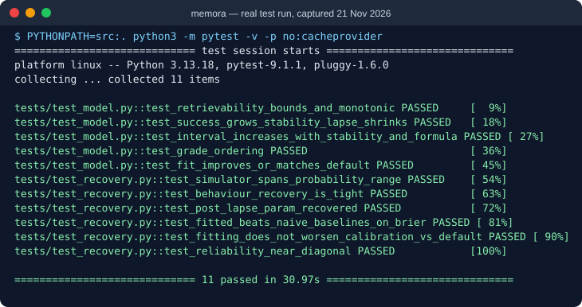

# Memora — an adaptive spaced-repetition engine — manual

*One page, eight blocks. Every figure here comes from this repository's own tests and README.*

## 1. Claim
The fitted scheduler predicts recall with a Brier score of 0.10, against 0.23 and 0.41 for the two baselines, and recovers known forgetting behaviour within an MAE of about 0.012.

## 2. What it is
Memora decides when a learner should next review each card, aiming for the point just before they would forget it. It learns its parameters from real review logs and is checked for calibration, so its predictions can be trusted.

## 3. Demo
Interactive simulator: `streamlit run sim/app.py`. Static evidence: `docs/benchmark.png` and `docs/recovery.png`.


*Real output from this repository's own tests, captured 21 Nov 2026.*

## 4. Run it yourself
**Prerequisites:** Python 3 and pip.

```bash
pip install -e ".[sim,bench,dev]"
PYTHONPATH=src pytest -q
PYTHONPATH=src python benchmarks/recovery.py
```

## 5. What you will see
11 tests pass. The recovery benchmark prints parameter recovery and calibration figures in line with the README (behaviour MAE about 0.012; Brier 0.10).

## 6. 30-second talking point
> A learning product is only worth what learners remember. Memora schedules each review against a target retention and fits itself to recall data. I validated it the way you validate a forgetting model without human trials: recover a known ground truth, then check calibration.

## 7. Scope and limits
- The benchmark uses synthetic logs. The same harness accepts real review logs unchanged.
- Some parameters are weakly identified by recall data alone. This is reported per parameter, not hidden.

## 8. Links
[Repository](https://github.com/fhionnghaile/memora) · [README](README.md)
