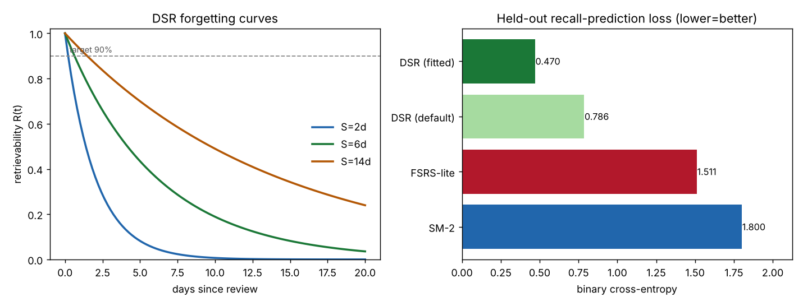
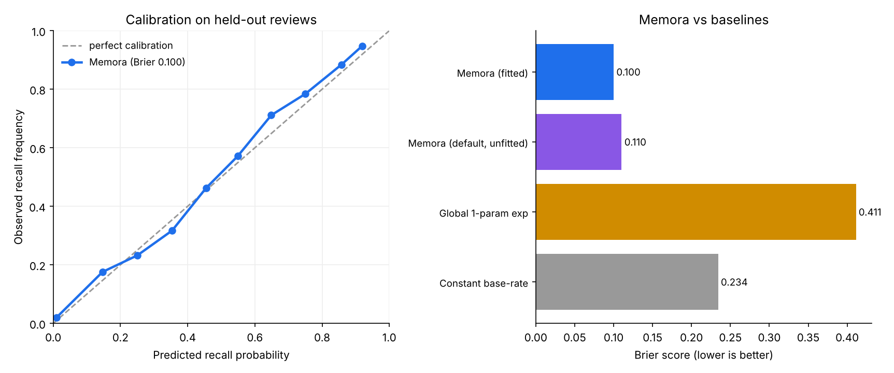

# Memora - an adaptive spaced-repetition engine

<!-- at-a-glance -->
> **An adaptive spaced-repetition engine that schedules review to the edge of forgetting — and proves it is calibrated.**  
> **Result:** 11 unit tests + a parameter-recovery & calibration benchmark (behaviour MAE 0.012; Brier 0.10 vs 0.23/0.41 baselines).  
> **Reproduce:** `pip install -e . && pytest -q   # benchmark: python benchmarks/recovery.py`  
> 
>
> **What this is worth:** Turns study time into retention: fewer reviews for the same recall — the whole value proposition of a learning product.


A typed **Difficulty-Stability-Retrievability (DSR)** scheduler: it models each card's memory
*stability* and *difficulty*, predicts recall with a forgetting curve, schedules the next review to
hit a target retention, and **fits its parameters to real recall logs** with SciPy.

## Install
```bash
pip install -e .            # core (numpy, scipy)
pip install -e ".[sim,bench,dev]"   # + simulator, benchmark, tests
```

## Quickstart
```python
from memora import Scheduler
s = Scheduler()
card = s.init_card(grade=3, now=0)        # a new card, graded "Good"
due_in = s.next_interval(card, request_retention=0.9)   # days until 90% retention
card = s.review(card, grade=3, now=due_in) # record a review -> stability grows
```
Fit to your own logs (`(card_id, grade, elapsed_days, recalled)`):
```python
from memora import fit
params, loss = fit(my_logs)
```

## Benchmark
Held-out recall-prediction loss on synthetic exponential-forgetting logs (400 train / 150 test).
Lower binary cross-entropy = better-calibrated recall probabilities.



| model | BCE (lower=better) |
|---|---|
| **DSR (fitted)** | **0.47** |
| DSR (default) | 0.79 |
| FSRS-lite | 1.51 |
| SM-2 | 1.80 |

Fitting the DSR parameters cuts recall-prediction loss by ~40% over the defaults and beats both
baselines on calibration. (FSRS-lite edges DSR on *ranking* AUC - an honest trade-off; calibration
is what matters when you schedule to a retention target.) Reproduce:
`PYTHONPATH=src python benchmarks/run.py`.

## Validation — parameter recovery & calibration

Beyond held-out loss, the model is validated the way you validate a forgetting model without
human subjects: recover a known ground truth, then check calibration.

**Parameter recovery.** Generate logs from a known DSR ground truth, fit from the defaults, and
the fitted model reproduces the true forgetting *behaviour* within **MAE ≈ 0.012** predicted
recall over 12 seeds. Each parameter is recovered only as well as the events that exercise it,
and the study reports that honestly — post-lapse retention and the stability-growth term are
strongly identified; a parameter touched only by rare grade-4 reviews is not.

**Calibration.** On held-out reviews the predicted probabilities track observed recall along the
diagonal (reliability diagram), with a **Brier score of 0.10** — versus 0.23 for a constant
base-rate and 0.41 for a state-blind exponential; fitting also improves Brier over the defaults.



Synthetic logs; the same harness accepts real review logs unchanged (swap `simulate_logs` for
your data). Reproduce: `PYTHONPATH=src python benchmarks/recovery.py` and
`PYTHONPATH=src pytest tests/test_recovery.py`.

## Live simulator
```bash
streamlit run sim/app.py
```
Adjust target retention and grades; watch intervals, stability and the due-queue respond.

## Tests
```bash
PYTHONPATH=src pytest -q
```

## License
MIT.

## Key decisions

- A Difficulty–Stability–Retrievability model fitted to recall logs, not fixed SM-2 intervals.
- Validated by parameter recovery + calibration (the honest way without human trials), with per-parameter identifiability reported.
- Pure, typed core; numpy/scipy only at the fit/benchmark boundary.

## Scope & limits

- The benchmark runs on synthetic logs; the same harness takes real review logs unchanged.
- Some parameters are weakly identified by recall data alone (reported, not hidden).

